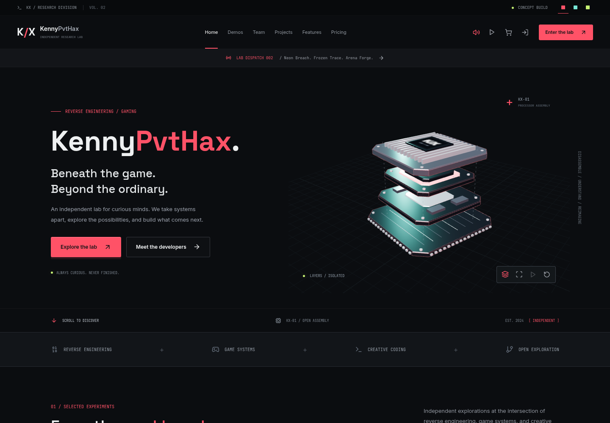

# KennyPvtHax / 3D Lab

VPS-friendly FastAPI + React source for a fictional reverse-engineering and gaming themed website.

An interactive processor assembly, three persistent visual themes, subtle click
audio, motion controls, responsive project pages, and a dedicated developer roster.
The interface and media are self-hosted. The original project is
[saptansh69-hub/KennyPvtHaxWeb](https://github.com/saptansh69-hub/KennyPvtHaxWeb).



[Interactive lab](previews/demos-desktop.png) | [Developer roster](previews/team-desktop.png) | [Mobile preview](previews/home-mobile.png)

The React app builds into static files, then `build.sh` copies them into `backend/static`. FastAPI serves both the API under `/api` and the React single-page app from the same origin.

## Layout

```text
backend/server.py      FastAPI app, Mongo access, Telegram webhook, SPA hosting
backend/static/        generated by build.sh
frontend/              React SPA
frontend/src/mock.js   demo content, navigation, team and design directions
build.sh               production build script for VPS use
requirements.txt       Python runtime dependencies
requirements-dev.txt   local test/lint dependencies
```

## Local Development

```bash
pip install -r requirements-dev.txt
cd frontend && npm ci && cd ..

# terminal 1: API on :8000
cd backend
cp .env.example .env
uvicorn server:app --reload --host 0.0.0.0 --port 8000

# terminal 2: React dev server on :3000
cd frontend
REACT_APP_BACKEND_URL=http://localhost:8000 npm start
```

Use `npm`, not Yarn. The lockfile and build script are npm-based.

For a frontend-only preview, run `npm start` in `frontend/`. The community feed
falls back to sample entries when the API is unavailable. Authentication, order
submission, and review submission require the configured backend.

## Production Build

```bash
bash build.sh
cd backend
uvicorn server:app --host 0.0.0.0 --port 8000
```

After this, put Nginx, Caddy, Apache, or your VPS panel proxy in front of `127.0.0.1:8000`.

## Required Environment

Create `backend/.env` or provide these variables through your process manager:

```env
MONGO_URL=mongodb://127.0.0.1:27017
JWT_SECRET=replace-with-a-long-random-secret
DB_NAME=appdb
PUBLIC_BASE_URL=https://your-domain.com
```

Optional Telegram/admin variables are documented in [backend/.env.example](backend/.env.example).

## PM2 Example

```bash
npm install -g pm2
bash build.sh
cd backend
pm2 start "uvicorn server:app --host 127.0.0.1 --port 8000" --name kennypvthax
pm2 save
```

## Nginx Example

```nginx
server {
    listen 80;
    server_name your-domain.com;

    location / {
        proxy_pass http://127.0.0.1:8000;
        proxy_set_header Host $host;
        proxy_set_header X-Real-IP $remote_addr;
        proxy_set_header X-Forwarded-For $proxy_add_x_forwarded_for;
        proxy_set_header X-Forwarded-Proto $scheme;
    }
}
```

Enable HTTPS with Certbot or your VPS panel after the site is reachable on HTTP.
